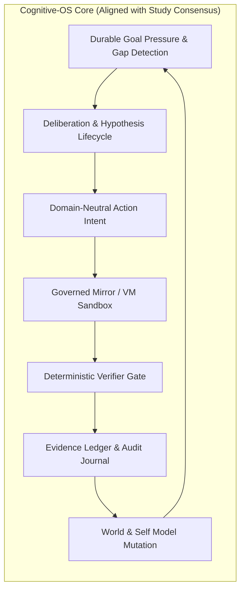

# Research Packet: AI-Generated AGI Architecture Proposals

## Executive Summary

This research packet presents a comprehensive collection, taxonomy, and comparative evaluation of **Artificial General Intelligence (AGI) architecture proposals** generated by **8 distinct frontier AI model families**. 

Historically, agentic systems have operated as shallow "LLM wrappers"—fragile loops that prompt a language model, execute raw shell commands, and hope for success. As recognized in Cognitive-OS's *AGI North Star* (`docs/agi-north-star.md`), achieving true general intelligence requires moving away from the "LLM amplifier" pattern toward a **verifiable, local-first, evidence-governed cognitive runtime** that maintains durable goals, forms competing hypotheses, runs discriminating experiments, respects dual world/self models, enforces strict action governance, and learns from failure.

To inform the architectural evolution of Cognitive-OS, this study systematically elicited, preserved, and cross-analyzed AGI system proposals from 8 leading AI lineages using a standardized elicitation protocol.

---

## 1. Study Scope & Participating Model Families

The study investigates 8 distinct frontier model families representing closed-source commercial flagships, specialized reasoning engines, and premier open-weights architectures:

| # | Model Family | Representative Systems | Core Architectural Identity |
|---|---|---|---|
| 1 | **OpenAI** | GPT-4o, o1, o3-mini | *Omni-Cognitive Agentic Fabric (OCAF)*: Hierarchical executive control with MCTS deliberation and containerized sandboxes. |
| 2 | **Anthropic** | Claude 3.5 Sonnet, Claude 3 Opus | *Constitutional Cognitive Operating Core (CCOC)*: Tri-partite epistemic humility with intrinsic constitutional invariants and formal proof verification. |
| 3 | **Google** | Gemini 2.0 Flash, Gemini 1.5 Pro | *Multimodal World-Model Memory Engine (MWM-ME)*: Predictive world simulation over massive (1M+ token) multimodal context lattices. |
| 4 | **DeepSeek** | DeepSeek-R1, DeepSeek-V3 | *Incentivized Reasoner-Critic Dual Pipeline (IR-CDP)*: Pure RL-incentivized deliberation, formal verification, and dense-MoE specialization. |
| 5 | **xAI** | Grok-2 | *Real-Time Grounded Agentic Network (RT-GAN)*: Adversarial multi-agent debate (Proponent/Skeptic/Synthesizer) with live real-time truth grounding. |
| 6 | **Alibaba Cloud** | Qwen 2.5 72B, Qwen-Max | *Hierarchical Cognitive Matrix with Structured Knowledge Synthesis (HCM-SKS)*: Enterprise-scale neuro-symbolic knowledge graphs and multi-level outcome verification. |
| 7 | **Meta** | Llama 3.3 70B / 405B | *Open-Weights Modular Cognitive OS (OW-MCOS)*: Decentralized, transparent, and sovereign actor-critic architecture with local vector-graph memory. |
| 8 | **Mistral AI** | Mistral Large 2 | *Compact Modular Agentic Kernel (CMAK)*: High-density sovereign reasoning kernel driven by formal code synthesis, minimal footprint, and deterministic linters. |

---

## 2. Research Methodology & Protocol

### A. Elicitation Protocol
All models were presented with the **Canonical Uniform Prompt** (fully documented in [`prompts.md`](./prompts.md)). The prompt explicitly forbade superficial chat-bot or prompt-chaining patterns and mandated deep structural specifications across 7 core cognitive dimensions:
1. Architectural Paradigm & Guiding Philosophy
2. Multi-Tiered Memory Hierarchy
3. Deliberation & Reasoning Mechanics (System 1 vs. System 2)
4. Dual World & Self Models
5. Governed Action, Sandboxing, & Boundary Security
6. Verification & Ground-Truth Anchoring
7. Meta-Learning, Self-Evolution, & Failure Containment

### B. Standardized Evaluation Dimensions
Proposals were analyzed and scored across 6 rigorous comparative axes:
- **Cognitive Paradigm**: How reasoning and control are structured.
- **Memory Topology**: Storage tiers, indexing paradigms, and context persistence.
- **Hypothesis & Search**: Deliberation algorithms, exploration mechanics, and falsification.
- **World vs. Self Model**: Explicit separation between external state and internal capability/health.
- **Action Governance & Boundaries**: Sandboxing, execution enclaves, and blast-radius containment.
- **Verification & Learning**: Deterministic checks, credit assignment, and recovery loops.

---

## 3. Comprehensive Cross-Model Comparison Matrix

| Comparative Dimension | OpenAI (GPT-4o / o1) | Anthropic (Claude 3.5) | Google (Gemini 2.0) | DeepSeek (R1 / V3) | xAI (Grok-2) | Alibaba (Qwen 2.5) | Meta (Llama 3.3) | Mistral (Mistral Large 2) |
|---|---|---|---|---|---|---|---|---|
| **Primary Paradigm** | Hierarchical Executive & MCTS | Epistemic Calibrated Constitution | Predictive Multimodal World Simulation | Pure RL Reasoner-Critic Dual Pipeline | Multi-Agent Adversarial Debate | Neuro-Symbolic Cognitive Matrix | Decentralized Open-Weights Actor-Critic | Compact Sovereign Agentic Kernel |
| **Reasoning Engine** | System 1 Intuition + System 2 MCTS | Bayesian Hypothesis-Testing + Critic | Counterfactual Multimodal Rollouts | Extended `<think>` Trajectories + Backtrack | Dialectic Debate (Proponent vs. Skeptic) | Hierarchical Task Decomposer (DAG) | Beam Search over Candidate Patches | Code-Centric Micro-Script Synthesis |
| **Memory Architecture** | Dynamic KV + SQLite Episodic + GraphRAG | Formal Register + Evidence Journal | 1M+ Native Context + Long-Term Tape | Scratchpad + RL Experience Replay | Live Fact Matrix + Failure Ledger | Semantic Graph + Case Base | Local Vector-Graph (DuckDB/LanceDB) | Sliding Window + Compressed Cache |
| **World Model** | Entity-Relationship Graph | Causal Bayesian Network | Generative Next-State Multimodal Sim | Symbolic Logic & Type State Graph | Real-Time Dynamic Dependency Model | Enterprise System & API Graph | Local Codebase AST & Commit Map | Compact Environment State Machine |
| **Self Model** | Resource Quotas & Capability Scores | Calibration Curve & Confidence Vector | Telemetry Tracker & Context Saturation | Quantitative Reward History & Search Depth | Computational Cost & Uncertainty Metrics | Hardware/Cost Quotas & Domain Profiles | Local GPU/VRAM & Latency Limits | Execution Latency & Tool Reliability |
| **Action Sandbox** | Isolated MicroVMs / Containers | Capability Rings (Ring 0 to Ring 3) | Hermetic Firecracker / Apple VM | AST Syntax Gate + Process Jails | eBPF-monitored Container Jails | Unified Enterprise Tool Bus + Staging | Local Docker / nspawn (Zero Cloud) | Sovereign Bubblewrap Linux Containers |
| **Verification Gate** | Deterministic Test & Hash Diff | Formal Invariant & Proof Verifier | Surprise Metric ($-\log P(O \mid S)$) | Rule-Based Reward System (RBRS) | Empirical Test & Regression Suite | 4-Tier Matrix (Syntax to Business) | Native Test Suite (`pytest`/`cargo`) | Deterministic Compiler & Linters |
| **Self-Evolution** | Automated Post-Mortem Analysis | Structured Retrospective Synthesis | Offline Batch Distillation | Asynchronous GRPO Self-Play RL | Synthetic Adversarial Benchmarks | Procedural Macro Compilation | Local LoRA Fine-Tuning via DPO | Deterministic Recipe Compilation |
| **Safety Invariant** | Anti-Goodhart Multi-Objective Bounds | Intrinsic Constitutional Invariants | Non-Destructive Simulation Gate | AST & Contract-Level Constraints | Adversarial Pre-Execution Veto | RBAC & Transactional Rollbacks | Llama-Guard Classifiers & Reversible Patches | Sovereign No-Egress & Code Linters |

---

## 4. Headline Findings: Consensus and Divergence

### A. Architectural Consensus (Universal Design Principles)
Across all 8 frontier models, several universal architectural imperatives emerged, providing strong empirical consensus for next-generation cognitive system design:

1. **Rejection of Unstructured Prompt Chains**: Every model family explicitly abandoned raw prompting loops, demanding strongly-typed, schema-validated intermediate representations (e.g., JSON contracts, AST trees, formal logic frames).
2. **Dual-Model Decoupling (World vs. Self)**: Not a single frontier model proposed conflating environment tracking with runtime health. All 8 proposals strictly separated the **World Model** (external state, dependencies, entity relationships) from the **Self Model** (budget consumption, tool reliability, error history, capability limits).
3. **Multi-Tiered Memory Stratification**: All systems converged on a 4-tier memory hierarchy:
   - High-speed immediate working memory (registers / KV-cache / scratchpads).
   - Structured episodic memory (journals / ledgers of past actions and outcomes).
   - Semantic knowledge bases (knowledge graphs / vector stores).
   - Procedural skill libraries (verified executable scripts / tool recipes).
4. **Mandatory Sandboxing & Execution Isolation**: Every proposal established that autonomous cognitive systems must not execute untrusted actions directly on host environments. Execution must occur inside containerized, capability-gated sandboxes (microVMs, containers, bubblewrap) with transactional rollback capabilities.
5. **Deterministic Verifier Supremacy**: LLMs cannot be trusted to judge their own success. Ground-truth evaluation must be anchored in objective, non-hallucinatory signals: compiler exit codes, unit test assertions, AST parsers, and formal invariants.

### B. Architectural Divergences (Competing Philosophies)
While agreeing on foundational components, the model families diverge sharply on execution philosophy:

1. **Centralized Hierarchical Control vs. Decentralized Swarms**:
   - *OpenAI, Anthropic, and Alibaba* favor a centralized executive orchestrator that strictly directs specialized sub-agents.
   - *xAI and Meta* advocate for decentralized, peer-to-peer adversarial debate (e.g., Proponent vs. Skeptic), arguing that centralized planners create single points of epistemic failure.
2. **Simulative Prediction vs. Formal Deduction**:
   - *Google (Gemini)* prioritizes **predictive counterfactual simulation**, arguing that the model should "dream" the consequence in continuous multimodal space before acting.
   - *DeepSeek and Mistral* prioritize **symbolic deduction and code generation**, arguing that writing and executing formal code tests is vastly more efficient and verifiable than neural simulation.
3. **Safety Architecture: Intrinsic Invariants vs. External Gatekeepers**:
   - *Anthropic (Claude)* embeds safety as an intrinsic constitutional invariant in the deliberative loss/state space.
   - *DeepSeek, Meta, and Mistral* enforce safety via external, non-bypassable runtime code contracts, AST filters, and independent safety judges (e.g., Llama-Guard).
4. **Context Window Strategy: Infinite Native Context vs. Compact Structured Retrieval**:
   - *Google* leverages massive native context (1M-2M tokens) for continuous stream preservation.
   - *Mistral and DeepSeek* argue for compact, dense working context combined with high-precision structured indexing, reducing memory overhead and inference latency.

---

## 5. Strategic Implications for Cognitive-OS

The findings of this study directly validate and reinforce the core design principles codified in Cognitive-OS's `docs/agi-north-star.md` and `core/conos_repository_layout.py`:



### Actionable Takeaways for Cognitive-OS Engineering:
1. **Reinforce Domain-Neutral Cognitive Cycle Contracts**:
   - The consensus across all frontier proposals supports Cognitive-OS's `CognitiveCycleFrame` contract (`core/cognition/`), ensuring that goal maintenance, hypothesis testing, and action intents remain strictly domain-neutral rather than tied to local coding workflows.
2. **Expand the Dual Self/World Model**:
   - Enhance the runtime self-model (`self_model/`) to track multi-dimensional metrics as recommended by Anthropic and DeepSeek: calibration curves (confidence vs. empirical verification), tool error frequencies, and compute search-depth budgeting.
3. **Elevate Hypothesis Falsification**:
   - Incorporate xAI's adversarial skeptic pattern into the deliberative engine (`decision/` and `planner/`): require every hypothesis to declare explicit empirical falsifiers before dispatching actions.
4. **Enforce Hermetic Sandbox Isolation**:
   - Continue development of the managed VM provider and empty-first mirror (`integrations/local_machine/` and `runtime/mirrors/`), adhering to the universal consensus that side-effects must remain fully sandboxed and reversibly snapshotted.
5. **Formalize Procedural Skill Compilation**:
   - Adopt the procedural distillation pattern (advocated by Mistral and Qwen): when a complex multi-tick hypothesis is verified by unit tests, compile the verified trajectory into a deterministic skill script within the procedural skills memory.

---

## 6. Directory Structure of this Research Packet

```text
research/ai_generated_agi_architectures/
├── README.md                           # This executive report, comparison matrix, and strategic analysis
├── prompts.md                          # Standardized elicitation prompt framework and model adaptations
└── models/                             # In-depth architectural proposals from individual model families
    ├── openai_gpt4o.md                 # Omni-Cognitive Agentic Fabric (OCAF)
    ├── anthropic_claude35_sonnet.md     # Constitutional Cognitive Operating Core (CCOC)
    ├── google_gemini2.md               # Multimodal World-Model Memory Engine (MWM-ME)
    ├── deepseek_r1_v3.md               # Incentivized Reasoner-Critic Dual Pipeline (IR-CDP)
    ├── xai_grok2.md                    # Real-Time Grounded Agentic Network (RT-GAN)
    ├── alibaba_qwen25.md               # Hierarchical Cognitive Matrix (HCM-SKS)
    ├── meta_llama33.md                 # Open-Weights Modular Cognitive OS (OW-MCOS)
    └── mistral_large2.md               # Compact Modular Agentic Kernel (CMAK)
```
