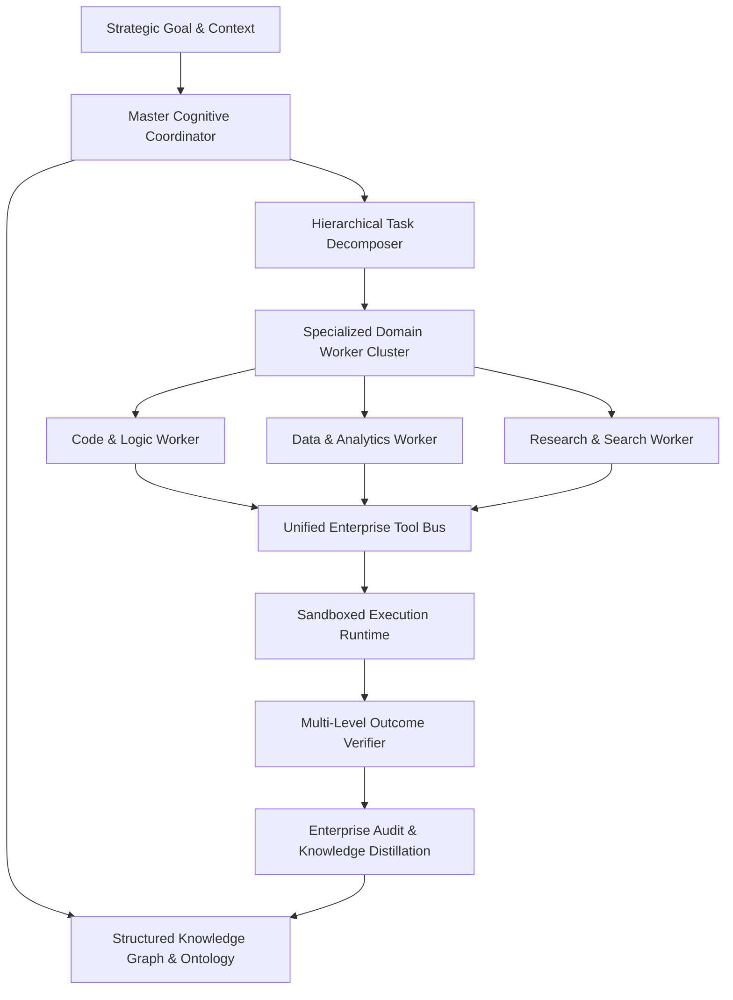

# Model Proposal: Alibaba Cloud Qwen 2.5 / Qwen-Max
## Architecture: Hierarchical Cognitive Matrix with Structured Knowledge Synthesis (HCM-SKS)

### 1. Executive Architectural Summary & Core Paradigm
Alibaba's proposal specifies the **Hierarchical Cognitive Matrix with Structured Knowledge Synthesis (HCM-SKS)**. The guiding design thesis is **Pragmatic Neuro-Symbolic Integration and Enterprise-Scale Knowledge Synthesis**. Qwen posits that general intelligence must bridge high-dimensional neural representations with dense, structured symbolic ontologies and robust multi-agent tool execution.

#### Core Architectural Tenets
- **Hybrid Dense-Symbolic Matrix**: Seamless two-way translation between neural latent representations and structured symbolic schemas (JSON/YAML/SQL).
- **Hierarchical Agent Specialization**: Multi-tier delegation separating strategic orchestration, domain-specialized problem solving, and low-level deterministic tool invocation.
- **Multilingual & Cross-Domain Generalization**: Robust conceptual mapping across diverse programming languages, human idioms, and specialized domain ontologies.

---

### 2. Cognitive Decomposition & Subsystems

#### A. Sensory & Multimodal Ingestion
- Universal multimodal encoder ingesting technical documents, spreadsheets, complex codebases, and structural diagrams.
- Contextual chunking and semantic tree parsing to preserve hierarchical code and document syntax.

#### B. Multi-Tiered Memory System
1. **Dynamic Task Buffer**: Fast scratchpad tracking multi-step sub-goal dependency trees.
2. **Structured Knowledge Graph**: Rich semantic network connecting entities, code repositories, schema definitions, and domain rules.
3. **Episodic Case Base**: Structured repository of past solved cases, mapping problem archetypes to verified solution plans.
4. **Tool & Action Registry**: Typed OpenAPI-compliant registry containing parameters, constraints, and side-effect profiles for all tools.

#### C. Deliberation & Reasoning Engine
- **Hierarchical Task Decomposition**:
  - Decomposes complex open-ended goals into a directed acyclic graph (DAG) of atomic sub-tasks.
  - Dynamically assigns sub-tasks to specialized worker agents based on required capability profiles.
- **Symbolic Verification Loops**:
  - Employs static analysis, type checking, and formal schema validation before emitting code to execution.

#### D. Dual World & Self Models
- **World Model**: Comprehensive graph representing available external systems, APIs, database tables, and operating system states.
- **Self Model**:
  - Granular inventory of model capabilities, execution latency profiles, and cost quotas.
  - Accurate confidence boundaries based on historical task performance across specific programming languages and domains.

#### E. Governed Action & Tool Execution
- **Unified Tool Bus**: Mediates all environment interactions via strict interface contracts.
- Rate-limiting, concurrency control, and transactional rollback mechanisms for all database and filesystem modifications.

#### F. Verification & Outcome Evaluation
- **Multi-Level Verifier Matrix**:
  1. *Level 1*: Syntactic correctness (AST validation, JSON schema conformance).
  2. *Level 2*: Execution integrity (process exit codes, stderr inspection).
  3. *Level 3*: Functional alignment (unit and regression test execution).
  4. *Level 4*: Business logic validation (post-condition state verification).

#### G. Meta-Learning & Self-Evolution
- **Continuous Knowledge Distillation**:
  - Solved complex workflows are automatically converted into reusable procedural macros and stored in the Episodic Case Base.
  - System identifies recurrent failure patterns and generates automated defensive rules for the Tool Bus.

---

### 3. Cognitive Loop (Tick Lifecycle)
1. **Goal Reception & Decomposition**: Deconstruct input goal into an executable sub-task DAG.
2. **Knowledge Augmentation**: Retrieve relevant entity subgraphs and historical cases from memory.
3. **Worker Delegation**: Dispatch sub-tasks to specialized domain workers (e.g., Code, Data, Search).
4. **Contract Verification**: Validate proposed tool invocations against OpenAPI schemas.
5. **Sandboxed Invocation**: Execute tools via the Unified Tool Bus; enforce timeouts.
6. **Matrix Verification**: Pass output through 4-tier verifier pipeline; determine ground truth.
7. **Knowledge Synthesis**: Commit verified updates to the Knowledge Graph and update case base.

---

### 4. Safety & Governance
- **Role-Based Access Control (RBAC)**: Worker agents only receive access to tools strictly required for their sub-task.
- **Deterministic Blast-Radius Containment**: File and data alterations are constrained to isolated staging areas until full verification passes.
- **Audit Immutability**: All tool calls, inputs, and raw outputs are recorded in a tamper-resistant operational log.
