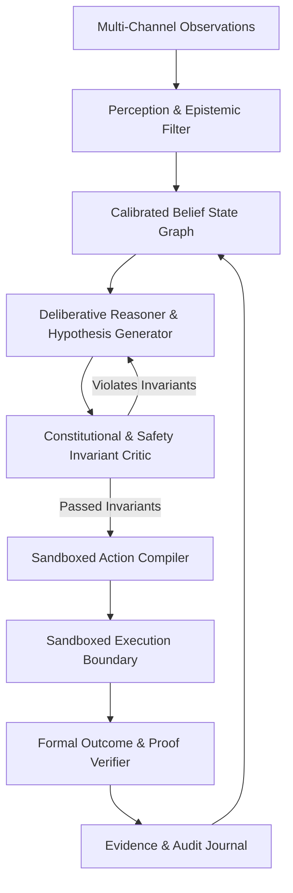

# Model Proposal: Anthropic Claude 3.5 Sonnet
## Architecture: Constitutional Cognitive Operating Core (CCOC)

### 1. Executive Architectural Summary & Core Paradigm
Anthropic's proposal emphasizes the **Constitutional Cognitive Operating Core (CCOC)**. The guiding design philosophy is **Epistemic Humility & Intrinsic Constitutional Alignment**. Rather than relying on external heuristic patch-guards, CCOC embeds safety, self-criticism, and formal verification directly into the cognitive state machine.

#### Core Architectural Tenets
- **Constitutional State Invariants**: Safety constraints are mathematical boundary conditions that invalidate unaligned trajectories before execution.
- **Epistemic Calibration**: Every assertion and hypothesis must carry a calibrated Bayesian probability score; overconfidence triggers deliberative re-audit.
- **Tri-Partite Cognitive Separation**: Clear isolation between Observer (Perception), Deliberator (Reasoning), and Verifier-Actor (Execution).

---

### 2. Cognitive Decomposition & Subsystems

#### A. Sensory & Multimodal Ingestion
- Multi-channel ingestion pipeline formatting all inputs into typed observation records.
- Semantic anomaly detection: Automatically tags observations that contradict existing beliefs with `HIGH_SURPRISE_FLAG`.

#### B. Multi-Tiered Memory System
1. **Working Memory Register**: Formal context containing the currently activated goal, explicit constraints, active hypotheses, and pending questions.
2. **Evidence Journal**: Immutable, cryptographically chained audit journal recording hypotheses, test designs, empirical outcomes, and posterior belief updates.
3. **Declarative & Conceptual Store**: Hierarchical ontology representing known causal mechanisms of the operating domain.
4. **Epistemic Archive**: Historical log of calibrated confidence vs. actual historical outcomes, used to recalibrate model uncertainty.

#### C. Deliberation & Reasoning Engine
- **Hypothesis-Experiment Engine**:
  - Treats all decisions as scientific hypotheses: $H = \{\text{Claim}, \text{Expected Observation}, \text{Falsifier}\}$.
  - Prioritizes actions that maximize **Information Gain** (epistemic exploration) when uncertainty is high, and goal completion when uncertainty is low.
- **Constitutional Critic**: Parallel reasoning pass verifying that proposed plans adhere to non-negotiable ethical, operational, and boundary invariants.

#### D. Dual World & Self Models
- **World Model**: Causal Bayesian network representing the environment. State transitions must include uncertainty bounds.
- **Self Model**: Comprehensive self-audit ledger:
  - Accurate mapping of known capabilities vs. blind spots.
  - Calibration curve of confidence vs. empirical success.
  - Active operational budgets (time, compute, memory, disk).

#### E. Governed Action & Tool Execution
- **Strict Least-Privilege Enclave**: Tools are grouped into capability rings (Ring 0: Pure read/compute, Ring 1: Sandboxed local mutation, Ring 2: Host mutation with snapshot, Ring 3: Network/human side-effects).
- Every Ring 2/3 action requires explicit lease granting and precondition verification.

#### F. Verification & Outcome Evaluation
- Distinguishes between **syntactic success** (process returned 0) and **semantic success** (intended invariant satisfied).
- Rejection of self-reported success: Evaluated by an independent verification sub-agent running deterministic checks.

#### G. Meta-Learning & Self-Evolution
- Does not modify foundational model weights dynamically at runtime.
- Employs **Structured Retrospective Synthesis**:
  - Compiles successful strategies into verified procedural guidelines.
  - Updates Bayesian priors in the causal world model.
  - Logs persistent anti-patterns into a negative retrieval bank.

---

### 3. Cognitive Loop (Tick Lifecycle)
1. **Perceive & Assess Surprise**: Ingest observation; compute surprise metric against current world model.
2. **Goal & Invariant Refresh**: Re-evaluate active goal against constitutional boundary rules.
3. **Formulate Hypotheses**: Generate competing explanations and discriminating experiments.
4. **Epistemic Gating**: Reject unaligned or uncalibrated actions via the Constitutional Critic.
5. **Lease Allocation & Sandbox Execution**: Grant temporary execution lease inside restricted container.
6. **Independent Verification**: Validate assertions and diffs using deterministic tests.
7. **Evidence Journal Commit**: Record cycle results and update world/self model priors.

---

### 4. Safety & Governance
- **Invariant Immutability**: Core constitutional guidelines cannot be rewritten or modified by the agent itself.
- **Fail-Safe Quorum**: When deliberation branches disagree or confidence is below threshold, the system safely halts and transitions to `WAITING_HUMAN`.
- **Epistemic Air-Gap**: The model evaluating safety cannot share mutable context memory with the action-generating agent.
