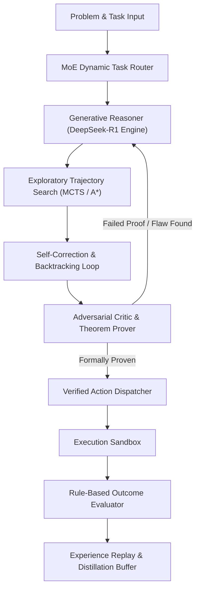

# Model Proposal: DeepSeek R1 / V3
## Architecture: Incentivized Reasoner-Critic Dual Pipeline (IR-CDP)

### 1. Executive Architectural Summary & Core Paradigm
DeepSeek's proposal details the **Incentivized Reasoner-Critic Dual Pipeline (IR-CDP)**. The central architectural thesis is that true autonomy and general capability are unlocked through **Large-Scale Reinforcement Learning (RL) over Verifiable Reasoning Trajectories** combined with a high-throughput **Mixture-of-Experts (MoE)** compute substrate.

#### Core Architectural Tenets
- **Emergent Deliberation via Pure RL**: Rejection of brittle human-engineered heuristics in favor of rule-based reward models that incentivize rigorous reflection, backtrack search, and verification.
- **Dual-Model Reasoner-Critic Coupling**: Separation of duties between an exploratory Generative Reasoner and an adversarial Deterministic Critic.
- **Dense-MoE Specialization**: Dynamic routing of cognitive sub-tasks (mathematics, code synthesis, logic, safety checks) to sparse, specialized expert pathways.

---

### 2. Cognitive Decomposition & Subsystems

#### A. Sensory & Multimodal Ingestion
- High-efficiency tokenizer with specialized tokens for code structures, mathematical formalism, and reasoning deliberation markers (`<think>`, `</think>`).
- Fast text and structured event ingestion with real-time semantic compression.

#### B. Multi-Tiered Memory System
1. **Active Reasoning Scratchpad**: Hidden reasoning token stream where the model explores, backtracks, and validates multiple branches before presenting output.
2. **Formal Experience Replay Ledger**: Storage of successful and failed reasoning trajectories, complete with step-by-step verification labels.
3. **Dense Code & Tool Knowledge Base**: Compressed vector and syntax index containing verified API documentation, standard libraries, and mathematical definitions.
4. **Procedural Action Memory**: Catalog of verified algorithmic templates and execution scripts.

#### C. Deliberation & Reasoning Engine
- **Incentivized Reasoner (R1 Core)**:
  - Generates extended reasoning traces using internal `<think>` blocks.
  - Automatically identifies sub-goals, formulates intermediate lemma proofs, and tests hypotheses against counter-examples.
  - Capable of self-prompted backtracking ("Wait, let me double check this assumption...").
- **Adversarial Critic**:
  - Independent validation agent that actively searches for edge cases, off-by-one errors, and boundary violations in the proposed plan.

#### D. Dual World & Self Models
- **World Model**: Symbolic state representation focusing on formal logic, type systems, and deterministic execution state.
- **Self Model**:
  - Quantitative reward history across domains (coding, reasoning, planning).
  - Explicit estimation of computational search depth required for given problem complexity.
  - Failure boundary ledger tracking known systematic reasoning biases.

#### E. Governed Action & Tool Execution
- **Formal Verification Gate**: Code or terminal actions must pass AST syntax parsing and static analysis checks before execution.
- Sandboxed execution environment with strict timeout, memory ceilings, and isolated file namespaces.

#### F. Verification & Outcome Evaluation
- **Rule-Based Reward System (RBRS)**:
  - Binary and numerical verification signals derived from compiler exits, test suite assertions, and formal theorem checkers.
  - Elimination of human-annotated reward model ambiguity; ground-truth evaluation is anchored in empirical reality.

#### G. Meta-Learning & Self-Evolution
- **Asynchronous RL Exploration Loop**:
  - Failed or high-difficulty tasks are saved to an offline exploration queue.
  - The system runs automated multi-turn self-play and search to discover winning trajectories, which are then used for Group Relative Policy Optimization (GRPO) model distillation.

---

### 3. Cognitive Loop (Tick Lifecycle)
1. **Task Formulation**: Parse objective into a formal constraint satisfaction or search problem.
2. **MoE Routing**: Route problem components to specialized expert clusters.
3. **Deep Deliberation (`<think>`)**: Generate long-horizon reasoning trajectories, exploring alternatives and performing self-correction.
4. **Adversarial Criticism**: Critic attempts to falsify the candidate plan using symbolic tests and edge cases.
5. **Sandboxed Trial**: Execute verified plan within restricted execution environment.
6. **Empirical Evaluation**: Evaluate compiler and runtime outputs via the Rule-Based Reward System.
7. **Buffer Experience**: Store trajectory with reward signal for continuous policy optimization.

---

### 4. Safety & Governance
- **Deterministic Boundary Enforcement**: Safety is enforced via non-bypassable code contracts and AST filters rather than soft prompt reminders.
- **Search-Depth Bounding**: Strict token and compute bounds prevent infinite recursive deliberation loops.
- **Cryptographic Auditability**: Every reasoning step in the `<think>` trajectory is logged for transparent offline safety inspection.
