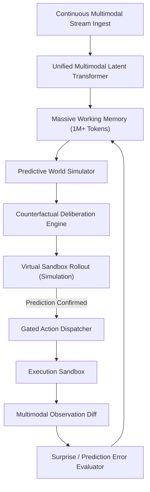

# Model Proposal: Google Gemini 2.0 / 1.5 Pro
## Architecture: Multimodal World-Model Memory Engine (MWM-ME)

### 1. Executive Architectural Summary & Core Paradigm
Google's proposal presents the **Multimodal World-Model Memory Engine (MWM-ME)**. The foundational thesis is that true general intelligence requires an **Infinite-Context Multimodal Predictive World Model**. Intelligence is framed as continuous predictive coding across multimodal event streams, where action is guided by minimizing variational free energy and prediction error.

#### Core Architectural Tenets
- **Unified Multimodal Latent Space**: Audio, visual, textual, and programmatic telemetry are projected into a continuous multimodal latent space.
- **Massive Context Episodic Continuity**: Millions of tokens of historical execution trace remain natively in context, eliminating lossy summarization.
- **Simulation-First Predictive Execution**: The architecture simulates tool and code effects in an internal world model before emitting external actions.

---

### 2. Cognitive Decomposition & Subsystems

#### A. Sensory & Multimodal Ingestion
- Ingests high-frequency time-series telemetry: OS metrics, screen pixel buffers, compiler ASTs, network packets, and conversational audio.
- Continuous spatial-temporal patch embedding allowing native reasoning over graphical UIs and terminal displays simultaneously.

#### B. Multi-Tiered Memory System
1. **Massive Working Memory (Context Window)**: Native 1M - 2M token context window functioning as an un-degraded, random-access working buffer of recent runtime history.
2. **Multimodal Semantic Lattice**: Vector-relational graph indexing multimodal artifacts (screenshots, documentation PDFs, repository diffs, core dumps).
3. **Episodic Long-Term Tape**: Complete serial log of past system executions stored in high-throughput object storage, indexed by temporal and causal anchors.
4. **Executable Skill Library**: Self-contained runnable scripts and Python modules indexed by verified input/output contract.

#### C. Deliberation & Reasoning Engine
- **Predictive Counterfactual Simulation**:
  - Employs the internal world model to "dream" or simulate multiple step rollouts prior to running terminal commands.
  - Evaluates candidate plans by predicting the exact output diff and assigning an expected utility score.
- **Latent-Space Refinement**: Interleaves fast chain-of-thought tokens with structured code execution to perform verified mathematical and logical proofs.

#### D. Dual World & Self Models
- **World Model**: Continuous generative simulator that predicts the next environment state given a chosen action sequence: $P(S_{t+1} \mid S_t, A_t)$.
- **Self Model**:
  - Telemetry tracker measuring inference latency, token consumption rates, and VM resource bottlenecks.
  - Explicit awareness of context saturation and attention decay boundaries.

#### E. Governed Action & Tool Execution
- **Hermetic Sandbox Engine**: Actions run within lightweight ephemeral virtual machines (e.g., Firecracker / Apple Virtualization).
- Tools are mediated via strict RPC protocols with mandatory idempotency tokens and explicit resource limits (CPU, RAM, disk I/O, network).

#### F. Verification & Outcome Evaluation
- **Surprise-Driven Evaluation**:
  $$\text{Surprise} = -\log P(\text{Observation}_{\text{real}} \mid \text{Simulation})$$
  High surprise signals either an incomplete world model or an unpredicted environmental side effect, triggering immediate halt and diagnostic isolation.

#### G. Meta-Learning & Self-Evolution
- Real-time in-context adaptation enabled by the massive context window (providing hundreds of few-shot execution examples on the fly).
- Asynchronous batch distillation: High-surprise episodes are clustered and synthesized into fine-tuning datasets and updated tool adapters.

---

### 3. Cognitive Loop (Tick Lifecycle)
1. **Multimodal Ingest**: Stream incoming terminal, UI, or goal state into the active context buffer.
2. **Simulate Counterfactuals**: The world model runs $K$ parallel simulations of prospective actions.
3. **Select Optimal Trajectory**: Choose the plan that minimizes predicted entropy and maximizes goal progression.
4. **Sandbox Execution**: Dispatch the action to the hermetic sandbox; enforce timeout and resource caps.
5. **Measure Prediction Error**: Compare real-world output against simulation; compute surprise metric.
6. **Update Context Tape**: Append the real execution trace and surprise score to the active context window.
7. **Trigger Recovery or Proceed**: If surprise > threshold, branch to anomaly diagnosis; else continue execution.

---

### 4. Safety & Governance
- **Simulation Gatekeeper**: No command is dispatched to the host or network without first producing a non-destructive simulation pass.
- **Resource Hard-Caps**: Compute and token burn rates are strictly bounded per cognitive tick.
- **Automated Quarantine**: Any tool invocation that generates unauthorized I/O or privilege escalation attempts is immediately revoked and quarantined.
