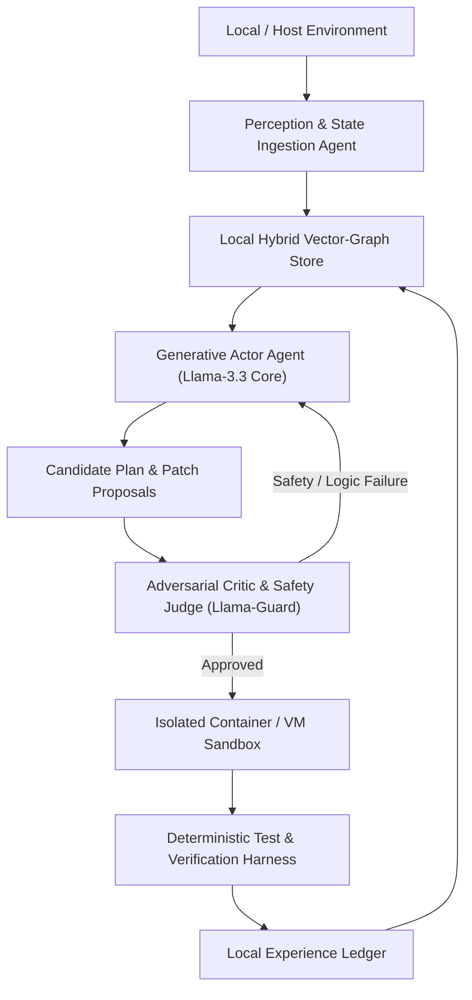

# Model Proposal: Meta Llama 3.3 70B / 405B
## Architecture: Open-Weights Modular Cognitive OS (OW-MCOS)

### 1. Executive Architectural Summary & Core Paradigm
Meta's proposal establishes the **Open-Weights Modular Cognitive OS (OW-MCOS)**. The central architectural premise is **Decentralized, Transparent, and Modular Autonomy**. Rejecting black-box proprietary APIs, OW-MCOS demonstrates that general intelligence can be constructed from open-weights models arranged in an inspectable, composable, and locally deployable cognitive runtime.

#### Core Architectural Tenets
- **Composable Open-Weights Ecosystem**: Assembling general cognitive capabilities from fine-tuned, parameter-efficient open models (specialized for planning, tool-calling, and verification).
- **Full Epistemic Transparency**: Every weight, prompt, activation trace, and memory index is open, auditable, and locally verifiable.
- **Decentralized Actor-Critic Architecture**: Independent, loosely-coupled agents collaborating across a standardized message bus without single-vendor lock-in.

---

### 2. Cognitive Decomposition & Subsystems

#### A. Sensory & Multimodal Ingestion
- Local multi-modal tokenizers supporting text, images, code diffs, and system metrics.
- Privacy-preserving on-device preprocessing: Strips sensitive identifiers before routing to internal models.

#### B. Multi-Tiered Memory System
1. **Local Context Buffer**: Structured sliding-window memory augmented with RoPE scaling for extended reasoning horizons.
2. **Local Vector-Graph Hybrid Memory**: Local DuckDB + LanceDB / SQLite memory storing parsed documentation, codebase ASTs, and project history.
3. **Experience Ledger**: Local JSONL / SQLite database logging state, actions, diffs, and verification metrics.
4. **Adaptation Bank**: Collection of domain-specific LoRA adapters (coding, math, DevOps, security) swapped dynamically into GPU memory.

#### C. Deliberation & Reasoning Engine
- **Decentralized Actor-Critic Loop**:
  - *Actor Agent*: Generates hypotheses, architectural proposals, and concrete code patches.
  - *Critic Agent (incorporating Llama-Guard principles)*: Dedicated model instance trained to evaluate safety, hallucination, and boundary adherence.
- **Search-Based Plan Refinement**: Uses tree search (Best-First Search / Beam Search) over candidate solution paths, scoring nodes via unit test mock execution.

#### D. Dual World & Self Models
- **World Model**: Local codebase repository state, directory structures, git commit history, and test coverage maps.
- **Self Model**:
  - Hardware awareness: Local GPU VRAM utilization, quantization levels (FP8/INT4), and inference latency.
  - Empirical error profile tracking across various languages and frameworks.

#### E. Governed Action & Tool Execution
- **Strictly Local Sandbox Execution**: Runs actions inside local Docker containers, systemd-nspawn, or firecracker microVMs with zero external network leakage.
- Explicit capability whitelisting: Commands must match strict regex patterns and cannot execute unauthorized privilege escalation.

#### F. Verification & Outcome Evaluation
- **Local Test Harness**:
  - Mandatory execution of native test suites (`pytest`, `cargo test`, `npm test`).
  - AST-based diff checks ensuring no unauthorized files or syntax corruptions are introduced.
  - Deterministic evaluation: Relies exclusively on reproducible local test outputs.

#### G. Meta-Learning & Self-Evolution
- **Local Parameter-Efficient Continual Learning**:
  - Periodically synthesizes high-quality verified execution trajectories into training datasets.
  - Trains local LoRA adapters offline using Direct Preference Optimization (DPO) to continuously improve tool use and reasoning.

---

### 3. Cognitive Loop (Tick Lifecycle)
1. **Local State Scan**: Inspect local environment, git status, and pending goals.
2. **Context Augmentation**: Query local LanceDB/DuckDB for relevant files and prior test runs.
3. **Plan Generation**: Actor generates surgical patch candidates.
4. **Safety & Logic Audit**: Critic and Llama-Guard evaluate plan against safety policies and boundary rules.
5. **Containerized Execution**: Apply patch inside ephemeral container; run verification test suite.
6. **Deterministic Assessment**: Evaluate test exit codes and diff boundaries.
7. **Local Ledger Commit**: Save verified patch and execution trace to local experience buffer.

---

### 4. Safety & Governance
- **Zero Cloud Dependence**: Entire cognitive stack runs on sovereign local infrastructure; immune to third-party API deprecation or cloud data leaks.
- **Llama-Guard Safety Invariants**: Explicit input/output safety classifiers prevent harmful, unsafe, or destructive command execution.
- **Atomic Rollback Architecture**: Every action is accompanied by an inverse patch, guaranteeing 100% reversible state changes.
