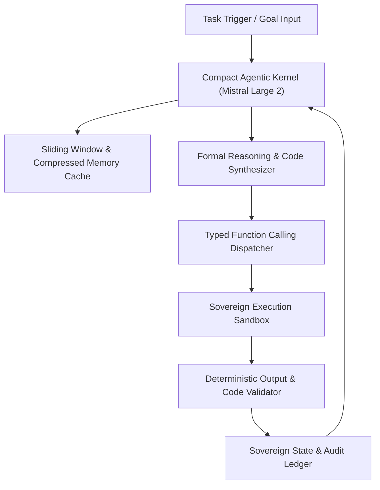

# Model Proposal: Mistral AI (Mistral Large 2 / Le Chat)
## Architecture: Compact Modular Agentic Kernel (CMAK)

### 1. Executive Architectural Summary & Core Paradigm
Mistral AI's proposal details the **Compact Modular Agentic Kernel (CMAK)**. The guiding design thesis is **High-Density Reasoning, Mathematical Precision, and Sovereign Efficiency**. Rejecting bloated monolithic systems, CMAK demonstrates that true general intelligence is achieved through lean, highly capable models with unmatched token efficiency, strict formal logic, and modular agency.

#### Core Architectural Tenets
- **High-Density Compact Intelligence**: Maximizing capability-per-parameter to enable low-latency, cost-effective, and sovereign enterprise deployment.
- **Formal Mathematical & Code Grounding**: Native mastery of formal languages, code synthesis, and multi-lingual technical tasks.
- **Strict Execution Isolation**: Clean boundary separation between cognitive deliberation and host execution environments.

---

### 2. Cognitive Decomposition & Subsystems

#### A. Sensory & Multimodal Ingestion
- High-efficiency byte-fallback BPE tokenizer optimized for multi-lingual syntax, complex code structures, and technical documentation.
- Fast streaming ingestion of file diffs, command outputs, and structured API payloads.

#### B. Multi-Tiered Memory System
1. **Sliding-Window Attention Buffer**: High-throughput localized working memory with native 128k context support.
2. **Structured Code & Documentation Index**: High-speed embedding-based retrieval index of project repositories and formal API specifications.
3. **Execution State Ledger**: Lightweight transactional database recording timestamps, commands executed, stdout/stderr captures, and verification statuses.
4. **Verified Pattern Cache**: Cache of verified code snippets and regex patterns that successfully passed verification.

#### C. Deliberation & Reasoning Engine
- **Formal Code-Centric Deliberation**:
  - Formulates complex reasoning tasks as executable Python or Bash algorithms rather than verbose prose.
  - Solves reasoning sub-tasks by writing, executing, and reading results of self-generated micro-scripts.
- **High-Precision Function Calling**:
  - Native, first-class function calling mechanism with strict JSON schema enforcement and zero syntax error tolerance.

#### D. Dual World & Self Models
- **World Model**: Compact representation of the environment state machine, including file tree hashes, active environment variables, and process trees.
- **Self Model**:
  - Exact awareness of token limits, processing speed (tokens/sec), and memory footprint.
  - Deterministic evaluation of its own tool reliability history.

#### E. Governed Action & Tool Execution
- **Sovereign Execution Sandbox**:
  - Sandboxed execution via Linux containers (`bubblewrap` / `cgroups v2`).
  - Strict network isolation; tools operate purely on mounted local volumes.
  - Atomic patch application: Patches must be validated with `git apply --check` before applying.

#### F. Verification & Outcome Evaluation
- **Deterministic Code Validator**:
  - Verification is binary and objective: compiler return codes, linter checks (`ruff`, `flake8`), and test suites (`pytest`).
  - Refuses to consider a task complete without positive confirmation from an independent validation command.

#### G. Meta-Learning & Self-Evolution
- **Modular Recipe Synthesis**:
  - After completing a task, CMAK distills the minimal sequence of verified steps into a deterministic script recipe.
  - Future occurrences of the problem archetype bypass deliberation and invoke the compiled recipe directly.

---

### 3. Cognitive Loop (Tick Lifecycle)
1. **Parse & Structure**: Convert input requirement into typed function definitions and success criteria.
2. **Context Assembly**: Retrieve minimal necessary files using exact symbol search and semantic indexing.
3. **Micro-Script Deliberation**: Synthesize minimal code patch or diagnostic probe.
4. **Pre-Flight Validation**: Validate patch syntax and formatting against linters and AST parsers.
5. **Sandboxed Run**: Execute action inside bubblewrap container with strict timeout.
6. **Deterministic Validation**: Inspect test output and exit code.
7. **Recipe Archive**: Log verified execution trace and update procedural recipe cache.

---

### 4. Safety & Governance
- **Zero Leakage Sovereignty**: Engineered for on-premises or sovereign cloud hosting with zero telemetry exfiltration.
- **Non-Bypassable Linters**: Code changes that violate style, security, or syntax rules are blocked automatically before runtime.
- **Minimal Privilege Footprint**: The kernel cannot perform operations outside the specifically designated working directory.
