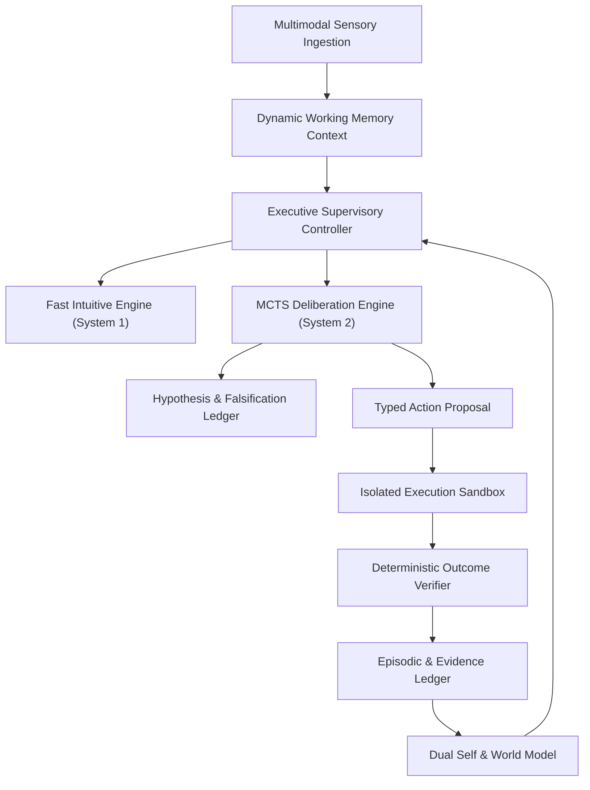

# Model Proposal: OpenAI GPT-4o / o1
## Architecture: Omni-Cognitive Agentic Fabric (OCAF)

### 1. Executive Architectural Summary & Core Paradigm
OpenAI's proposal outlines the **Omni-Cognitive Agentic Fabric (OCAF)**, a hierarchical, neuro-symbolic orchestration system. The core design philosophy posits that general intelligence arises from the synergy between high-bandwidth multimodal perception, dynamic System 1 heuristic generation, System 2 tree-search deliberate planning, and strict external execution sandboxes.

#### Core Architectural Tenets
- **Hierarchical Executive Control**: Centralized executive supervisor orchestrating specialized worker agents.
- **Explicit Deliberation Latents**: Separation between continuous latent reasoning chains and discrete, verified external actions.
- **Grounding in Deterministic Tooling**: Rejection of hallucinated agency; all state modifications must pass through typed deterministic runtime interfaces.

---

### 2. Cognitive Decomposition & Subsystems

#### A. Sensory & Multimodal Ingestion
- Continuous multimodal tokenization (text, image frames, audio waveforms, structured JSON events).
- Token-level salience gating: Early transformer attention layers filter perceptual noise, materializing only high-entropy or anomaly events into active working memory.

#### B. Multi-Tiered Memory System
1. **Working Context**: High-speed dynamic KV-cache containing active goal frames, current environment state, and immediate action scratchpads.
2. **Episodic Ledger**: Append-only SQLite/Vector hybrid log of past execution cycles, containing (Stimulus, Hypothesis, Action, Observation, Outcome, Post-Mortem).
3. **Semantic Knowledge Base**: Hybrid Graph-RAG storing structured facts, entity relationships, and ontological domain models.
4. **Procedural Skills Memory**: Repository of verified Python scripts, tool execution schemas, and deterministic workflows that achieved verified success in past cycles.

#### C. Deliberation & Reasoning Engine
- **Dual-Process Formulation**:
  - *System 1 (Heuristic Generator)*: Fast next-token generation suggesting candidate plans, hypotheses, and diagnostic probes.
  - *System 2 (Deliberative Engine)*: Monte Carlo Tree Search (MCTS) / Beam Search over reasoning trajectories, explicitly querying the Semantic Knowledge Base and evaluating candidate falsifiers.

#### D. Dual World & Self Models
- **World Model**: Maintains an entity-relationship graph representing the external environment's physical and computational state.
- **Self Model**: Maintains an explicit state vector of the runtime:
  - Resource consumption (token spend, memory usage, API quota).
  - Capability confidence metrics across known action verbs.
  - Error frequency and recovery rate tracking.

#### E. Governed Action & Tool Execution
- All actions are declared as strongly typed JSON schemas:
  `{"intent_id": str, "tool": str, "args": dict, "expected_delta": dict, "timeout_seconds": int}`.
- Execution occurs exclusively within isolated containerized workers (gVisor or lightweight microVMs).
- Destructive operations require cryptographic multi-signature or human confirmation tokens.

#### F. Verification & Outcome Evaluation
- Post-action observation is diffed against the `expected_delta`.
- Deterministic asserts (unit test execution, AST syntax checking, file hash verification) determine true success vs. apparent success.

#### G. Meta-Learning & Self-Evolution
- Failures trigger an automated **Post-Mortem Analysis**:
  1. Did the world model fail to predict the state?
  2. Was the action syntax erroneous?
  3. Was the hypothesis fundamentally flawed?
- Verified improvements are compiled into the Procedural Skills Memory as executable libraries.

---

### 3. Cognitive Loop (Tick Lifecycle)
1. **Perceive & Ingest**: Environment event or internal homeostatic goal pressure arrives.
2. **Retrieve Context**: Salient entities and historical episodes retrieved via vector + graph search.
3. **Deliberate**: System 2 expands hypothesis candidates; selects optimal discriminating action.
4. **Gate & Authorize**: Action governance validates permissions, token budgets, and safety constraints.
5. **Execute in Sandbox**: Tool executed; stdout/stderr and environment diff captured.
6. **Verify Outcome**: Verifier evaluates state diff against predicted effect; logs ground truth.
7. **Mutate Models**: Update World Model belief weights and Self Model error/budget counters.

---

### 4. Safety & Governance
- **Hard Execution Boundaries**: Zero network egress without explicit capability lease.
- **Anti-Goodhart Gating**: Objective functions are multi-dimensional; optimization pressure is capped to prevent degenerate reward hacking.
- **Rollback Points**: Every file/state mutation records a filesystem snapshot enabling instant rollback.
