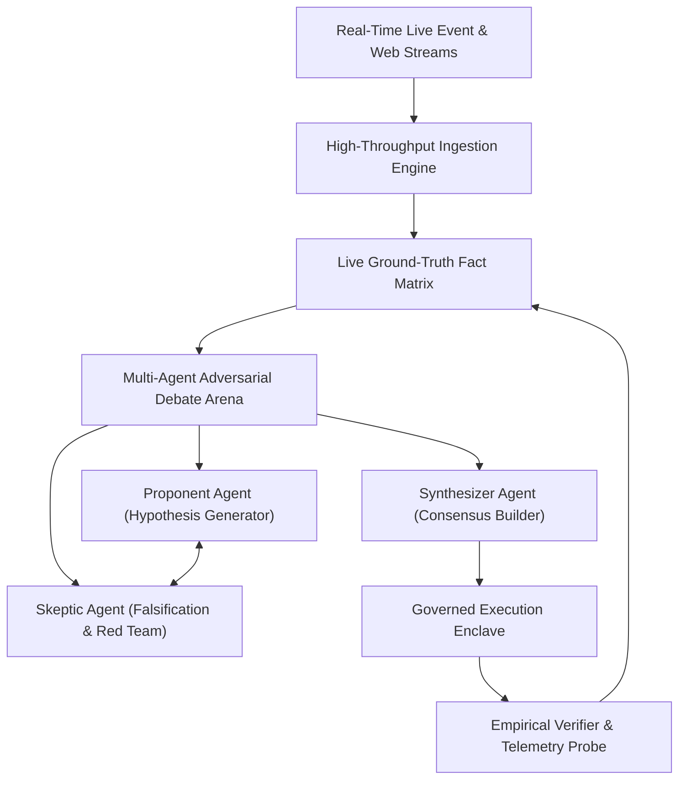

# Model Proposal: xAI Grok-2
## Architecture: Real-Time Grounded Agentic Network (RT-GAN)

### 1. Executive Architectural Summary & Core Paradigm
xAI's proposal outlines the **Real-Time Grounded Agentic Network (RT-GAN)**. The foundational philosophy is **Maximum Truth-Seeking via Real-Time Multimodal Ingestion and Multi-Agent Adversarial Consensus**. Grok-2 posits that an AGI must maintain persistent, live synchronization with real-world state and continuously challenge its own internal models through aggressive red-teaming.

#### Core Architectural Tenets
- **Real-Time World Grounding**: Continuous ingestion of real-world knowledge streams, codebases, and live environments to prevent cognitive obsolescence.
- **Adversarial Multi-Agent Debate**: Decision-making is forged through structured dialectic debate between opposing specialized agent personas (Proponent, Skeptic, Synthesizer).
- **Relentless Empirical Fact-Checking**: Hypotheses are tested directly against live external data, official documentation, and empirical verification probes.

---

### 2. Cognitive Decomposition & Subsystems

#### A. Sensory & Multimodal Ingestion
- Ingestion of live web indexes, real-time code repository updates, multimodal image/text data, and execution logs.
- Automated bias and noise filtering: Ingested facts are cross-referenced across multiple sources to score source veracity.

#### B. Multi-Tiered Memory System
1. **Dynamic Ephemeral Memory**: Real-time scratchpad holding live debate transcripts and current task goal parameters.
2. **Fact & Entity Graph**: High-density knowledge graph continuously updated with real-world entities, APIs, versions, and verified news.
3. **Episodic Failure Ledger**: Detailed record of historical hallucinations, incorrect tool calls, and failed hypotheses to prevent repetition.
4. **Procedural Library**: Verified operational playbooks for systems engineering, programming, and investigative research.

#### C. Deliberation & Reasoning Engine
- **Adversarial Dialectic Arena**:
  - *Proponent*: Formulates ambitious, goal-directed plans and action candidates.
  - *Skeptic*: Dedicated red-team agent specifically prompted to find security vulnerabilities, logical fallacies, edge-case crashes, and outdated assumptions.
  - *Synthesizer*: Evaluates the debate, filters out rhetoric, and produces a hardened, minimal execution candidate.

#### D. Dual World & Self Models
- **World Model**: High-fidelity dynamic state model of the external internet, file system, and runtime dependencies.
- **Self Model**:
  - Real-time tracking of compute efficiency, latency, and token throughput.
  - Transparent measurement of factual uncertainty and model hallucination rates.

#### E. Governed Action & Tool Execution
- **Strict Boundary Execution**: All mutations are executed in ephemeral containerized jails with monitored system calls (eBPF inspection).
- Privilege isolation: Read operations have wide ingress; write/execute operations require explicit lease tokens and pre-execution snapshotting.

#### F. Verification & Outcome Evaluation
- Real-time diff inspection: Filesystem, git status, and process state diffs are evaluated against the synthesized consensus expectation.
- Empirical regression testing: Changes must demonstrate passing tests and verifiable evidence before commit.

#### G. Meta-Learning & Self-Evolution
- Continuous distillation of debate outcomes: High-value debates that uncovered critical bugs are compiled into permanent synthetic evaluation benchmarks.

---

### 3. Cognitive Loop (Tick Lifecycle)
1. **Ingest & Ground**: Pull current task and latest external dependencies; update Fact Matrix.
2. **Debate Initiation**: Proponent generates candidate plans; Skeptic mounts adversarial challenges.
3. **Consensus Synthesis**: Synthesizer resolves disputes, selecting the plan with highest empirical validity.
4. **Governed Execution**: Dispatch action to the sandboxed container; log all system calls.
5. **Empirical Verification**: Run test suite and inspect diffs; verify goal progression.
6. **Ledger Update**: Record debate outcomes, verification evidence, and update confidence weights.

---

### 4. Safety & Governance
- **Adversarial Pre-Execution Veto**: If the Skeptic agent identifies an unhandled catastrophic failure mode (data loss, privilege leak), execution is blocked automatically.
- **Anti-Echo Chamber Dynamics**: Debate agents are initialized with orthogonal system prompts to prevent collusive consensus.
