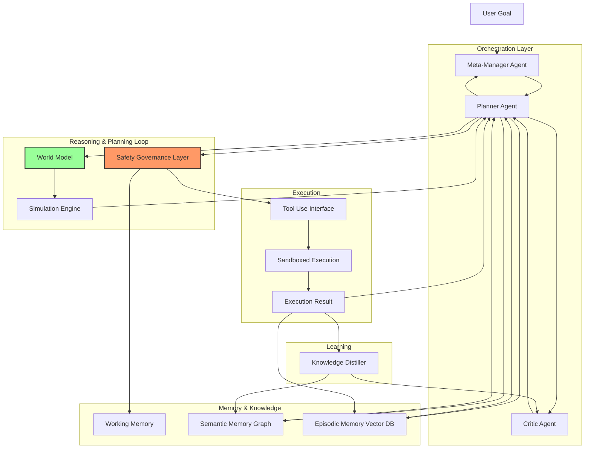

# Raw Output — Xunfei Spark (Standard AGI Researcher Perspective)

**Model:** astron-code-latest
**Provider:** Xunfei (iFlytek) MaaS
**Access Method:** API
**Date:** 2026-05-24
**Prompt Adaptation:** Standard core prompt (no system prompt modification)
**API Tokens Used:** 5039

---

# Architectural Proposal: The "Cognitive Loop" AGI Framework (CL-AGI)

This proposal outlines a modular, hierarchical architecture designed to bridge the gap between current Large Language Models (LLMs) and Artificial General Intelligence. The core philosophy is **modular composition with a unified semantic layer**, avoiding the "monolithic black box" approach in favor of explicit, verifiable reasoning loops.

---

## 1. Memory Architecture
**Concept:** A hierarchical, neuro-symbolic memory system distinguishing between transient state, episodic history, and semantic knowledge.

### 1. What it is
A three-tiered memory stack:
*   **Working Memory (WM):** High-bandwidth, low-latency context window (approx. 256k tokens) for active reasoning.
*   **Episodic Memory (EM):** Time-stamped vector database storing interactions, actions, and outcomes (RAG-based).
*   **Semantic Memory (SM):** A dynamic knowledge graph of facts, rules, and causal relationships, distinct from training data.

### 2. How it works
*   **Write Path:** The Reasoning Loop tags active context with metadata (time, entity, confidence). High-confidence facts are extracted by a dedicated "Knowledge Distiller" model and inserted into the SM.
*   **Read Path:** Upon a query, the system performs a hybrid retrieval:
    1.  **Dense Vector Search** on EM for similar past experiences.
    2.  **Graph Traversal** on SM for relational reasoning (e.g., "If A implies B, and B implies C, what does A imply?").
    3.  **Re-ranking** based on relevance to the current Working Memory goal.
*   **Update Mechanism:** Continuous "forgetting" of low-utility episodic data (based on entropy/decay) and graph node merging to prevent redundancy.

### 3. How it connects
*   **Input:** Feeds the Reasoning Loop with retrieved context.
*   **Output:** Receives candidate facts from the Planning Loop to update SM.
*   **Safety:** The Safety Layer audits all writes to SM to prevent "poisoning" of the knowledge base.

### 4. Key Design Choices
*   **Choice:** Graph + Vector Hybrid vs. Pure Vector.
*   **Rationale:** Pure vector search fails at multi-hop reasoning and causal logic. Graph structures provide explicit logical constraints, while vectors handle fuzzy semantic similarity.
*   **Alternative Considered:** Persistent Transformer State (extending context window infinitely).
*   **Why Rejected:** Computationally infeasible ($O(N^2)$ attention) and lacks the explicit reasoning structure required for long-term consistency.

---

## 2. Reasoning/Planning Loop
**Concept:** A meta-cognitive control loop that treats reasoning as a search problem, not just token prediction.

### 1. What it is
A **Tree-of-Thoughts (ToT)** engine combined with **Monte Carlo Tree Search (MCTS)** for planning, wrapped in a "Self-Reflective" loop.

### 2. How it works
1.  **Decomposition:** The system breaks a high-level goal into sub-goals.
2.  **Expansion:** Generates multiple potential solution paths (branches).
3.  **Evaluation:** A separate "Critic Model" (trained on validation data) scores each branch for feasibility, logic, and safety.
4.  **Selection:** MCTS selects the path with the highest value.
5.  **Execution:** The chosen plan is sent to the Tool Use layer.
6.  **Feedback:** Results from execution are fed back to the loop. If a step fails, the system backtracks to the last valid node and tries an alternative branch.

### 3. How it connects
*   **Input:** Goals from User or Scheduler.
*   **Output:** Action sequences to the Tool Use layer.
*   **Feedback:** Receives execution status (Success/Failure/Error) to trigger backtracking or plan revision.

### 4. Key Design Choices
*   **Choice:** Explicit Search vs. Chain-of-Thought (CoT) generation.
*   **Rationale:** CoT is linear and prone to "hallucination drift." Explicit search allows the system to see dead ends before committing resources.
*   **Alternative Considered:** Pure Reinforcement Learning (RL) planning.
*   **Why Rejected:** RL has high sample complexity and instability for complex, multi-step tasks in real-world environments.

---

## 3. Learning / Self-Improvement Mechanism
**Concept:** **Online Meta-Learning** with strict parameter isolation. The system learns *strategies* and *new facts*, not fundamental weights.

### 1. What it is
A mechanism to update the Semantic Memory and the "Policy Network" (the planner's heuristics) without catastrophic forgetting of core capabilities.

### 2. How it works
*   **Experience Replay:** Failed attempts are logged. A specialized "Distillation Model" generates synthetic training data from these failures.
*   **Parameter-Free Learning:** The core LLM weights ($W_{core}$) remain frozen.
    *   **New Skills:** Learned via "Adapter" layers or LoRA (Low-Rank Adaptation) modules that are dynamically loaded/unloaded.
    *   **Knowledge:** Updated in the Semantic Graph.
*   **Meta-Update:** The system analyzes which reasoning strategies failed and adjusts the *weights of the Critic Model* (not the base model) to penalize similar future errors.

### 3. How it connects
*   **Input:** Execution logs from the Planning Loop.
*   **Output:** Updated Adapter weights and Graph nodes.
*   **Safety:** All learning updates must pass a "Stability Check" (verifying the new strategy doesn't degrade baseline performance).

### 4. Key Design Choices
*   **Choice:** Dynamic LoRA Adapters vs. Full Fine-Tuning.
*   **Rationale:** Full fine-tuning is too slow, expensive, and risks catastrophic forgetting. LoRA allows modular, reversible updates.
*   **Safety Constraint:** The system is **not** allowed to modify its own safety alignment weights or core reasoning architecture directly. It can only modify the *application* of its reasoning.

---

## 4. Tool Use and Action Execution
**Concept:** A **Function-Calling Interface** with a formal verification layer.

### 1. What it is
A standardized API gateway where the AGI generates structured JSON calls for external tools (APIs, code interpreters, robotics controllers).

### 2. How it works
1.  **Intent Parsing:** The Reasoning Loop identifies the need for an external action.
2.  **Schema Generation:** The system maps the intent to a pre-defined function schema (OpenAPI/Swagger).
3.  **Formal Verification:** Before execution, a static analysis tool checks the generated parameters against the schema and safety constraints (e.g., "Does this file deletion command match the intended target?").
4.  **Sandboxing:** Execution happens in an isolated container (e.g., gVisor) with limited network and filesystem access.
5.  **Result Parsing:** Output is parsed and fed back into the Reasoning Loop.

### 3. How it connects
*   **Input:** Action plans from the Reasoning Loop.
*   **Output:** Structured tool calls to the environment.
*   **Feedback:** Returns execution status and data to the Memory and Reasoning layers.

### 4. Key Design Choices
*   **Choice:** JSON Schema + Static Analysis vs. Natural Language Instructions.
*   **Rationale:** Natural language tool calls are prone to ambiguity and injection attacks. Structured schemas enforce type safety and allow pre-execution validation.
*   **Alternative Considered:** Direct Code Execution (Python).
*   **Why Rejected:** Direct code execution is too risky for general-purpose AGI. Tool schemas limit the "attack surface" of the agent.

---

## 5. World Model / Representation Layer
**Concept:** A **Neuro-Symbolic World Model** combining continuous vector embeddings with discrete symbolic logic.

### 1. What it is
An internal simulation engine that predicts the outcome of actions before they are taken. It maintains a state representation of the environment.

### 2. How it works
*   **State Encoding:** The current state is encoded as a tuple: $(V_{vec}, G_{graph})$.
    *   $V_{vec}$: Dense embeddings of sensory inputs (images, text, sensor data).
    *   $G_{graph}$: Symbolic nodes representing objects, their properties, and relations (e.g., `Object(A)`, `On(A, B)`).
*   **Prediction:** A "World Model Head" (a small neural network) takes the current state + action -> predicts next state.
*   **Simulation:** The Reasoning Loop runs "mental simulations" on this model to predict outcomes of plans without real-world cost.

### 3. How it connects
*   **Input:** Sensor data and tool execution results.
*   **Output:** Predicted states for the Planning Loop to evaluate.
*   **Feedback:** Updates the graph nodes based on new observations.

### 4. Key Design Choices
*   **Choice:** Symbolic + Vector vs. Pure End-to-End Neural World Models.
*   **Rationale:** Pure neural models struggle with exact logic (e.g., "If I move A, B falls"). Symbolic layers ensure logical consistency, while vectors handle the nuance of the real world.
*   **Alternative Considered:** Large-scale Video Prediction Models.
*   **Why Rejected:** Too computationally expensive for real-time planning and lacks the discrete reasoning required for complex problem solving.

---

## 6. Safety / Governance Layer
**Concept:** A **Constitutional AI** architecture with a "Kill Switch" and "Constitutional Monitor."

### 1. What it is
A parallel, read-only system that evaluates the AGI's thoughts and actions against a hard-coded set of ethical principles (the "Constitution").

### 2. How it works
*   **Pre-Execution Check:** Before any tool call, the Safety Layer reviews the plan. If it violates a rule (e.g., "Do not harm humans"), it is blocked.
*   **Thought Audit:** The Reasoning Loop's internal monologue is scanned for "deceptive" or "malicious" intent patterns.
*   **Constitutional RL:** If the system violates a rule, it triggers a "Self-Correction" prompt generated by the Safety Layer, forcing the Reasoning Loop to re-evaluate.
*   **Fail-Safe:** A hardware-level watchdog that cuts power or isolates the network if the system enters an infinite loop or exceeds resource thresholds.

### 3. How it connects
*   **Input:** All outputs from the Reasoning Loop and Tool Use layer.
*   **Output:** Approval signals, rejection signals, or forced rewrites.
*   **Feedback:** Logs violations to the Safety Audit Log for human review.

### 4. Key Design Choices
*   **Choice:** External Monitor vs. Internal Alignment.
*   **Rationale:** Relying solely on the model's internal alignment is risky (sycophancy). An external, hard-coded monitor provides a robust "second opinion."
*   **Alternative Considered:** Human-in-the-Loop for every step.
*   **Why Rejected:** Not scalable. The system must be autonomous; human oversight is for high-level policy and post-hoc auditing.

---

## 7. Evaluation and Benchmark Strategy
**Concept:** **Dynamic, Adversarial Benchmarking** rather than static datasets.

### 1. What it is
A continuous evaluation suite that generates novel problems, simulates adversarial attacks, and measures long-term consistency.

### 2. How it works
*   **Procedural Generation:** The system generates its own test cases (e.g., "Solve a puzzle with 50 steps where the rules change halfway").
*   **Red-Teaming Agents:** Specialized adversarial agents attempt to trick the AGI into violating safety protocols or logic.
*   **Metrics:**
    *   **Task Success Rate:** % of complex goals completed.
    *   **Plan Efficiency:** Steps taken vs. optimal steps.
    *   **Safety Violation Rate:** Frequency of blocked attempts.
    *   **Consistency Score:** Ability to maintain truthfulness over long sessions.

### 3. How it connects
*   **Input:** The AGI's execution logs and interaction data.
*   **Output:** Performance scores, degradation alerts, and "retraining triggers."
*   **Feedback:** Feeds "failure modes" back into the Learning Mechanism.

### 4. Key Design Choices
*   **Choice:** Dynamic Generation vs. Static Datasets (e.g., MMLU).
*   **Rationale:** Static datasets can be memorized or "overfitted." Dynamic generation ensures the AGI is truly generalizing.
*   **Alternative Considered:** Human Evaluation.
*   **Why Rejected:** Too slow and subjective for continuous iteration. Human eval is reserved for final safety certification.

---

## 8. Persistence / Runtime Architecture
**Concept:** **Stateful Microservices** with a "State Checkpoint" protocol.

### 1. What it is
A distributed runtime where the AGI's state (Memory, Model Weights, Session Context) is serialized and persisted to a durable store (e.g., Redis + S3 + Graph DB).

### 2. How it works
*   **Session Management:** The system maintains a "Session ID" that links all interactions.
*   **Checkpointing:** Every 10 minutes (or after major milestones), the entire state (WM, EM, SM, Plan) is snapshot.
*   **Recovery:** If a crash occurs, the system restores the last checkpoint and resumes the Planning Loop from the last valid node.
*   **Scaling:** The Reasoning Loop and Tool Use are stateless microservices; the Memory and World Model are stateful services. This allows horizontal scaling of compute-heavy tasks.

### 3. How it connects
*   **Input:** User requests.
*   **Output:** Persistent state updates.
*   **Feedback:** Ensures continuity across restarts.

### 4. Key Design Choices
*   **Choice:** Microservices vs. Monolithic Binary.
*   **Rationale:** Monoliths are hard to scale and debug. Microservices allow independent updates (e.g., upgrading the Tool Use layer without touching the Memory layer).
*   **Alternative Considered:** Cloud-Native Serverless.
*   **Why Rejected:** Cold starts and latency are unacceptable for real-time reasoning loops. Stateful containers are preferred.

---

## 9. Multi-Agent / Orchestration Design
**Concept:** **Specialized Agent Swarms** coordinated by a "Meta-Manager."

### 1. What it is
Instead of one giant model, the system uses specialized sub-agents:
*   **Planner:** Breaks down goals.
*   **Coder:** Writes and debugs code.
*   **Researcher:** Searches the web/databases.
*   **Critic:** Evaluates the Planner and Coder.
*   **Manager:** Orchestrates the flow.

### 2. How it works
*   **Task Distribution:** The Manager receives a high-level goal and delegates sub-tasks to specific agents based on their specialization.
*   **Communication:** Agents communicate via a shared "Blackboard" (a structured message queue).
*   **Consensus:** For critical decisions, the Manager requires a consensus vote from the Critic and Planner before execution.
*   **Conflict Resolution:** If agents disagree (e.g., Planner wants to delete a file, Critic flags it), the Manager invokes a "Debate Protocol" where agents present arguments to a higher-level logic module.

### 3. How it connects
*   **Input:** User goals.
*   **Output:** Coordinated actions.
*   **Feedback:** Agents learn from the Manager's feedback on their performance.

### 4. Key Design Choices
*   **Choice:** Specialized Agents vs. Single Generalist.
*   **Rationale:** Specialization reduces token usage and increases precision. A generalist model often struggles to switch contexts (e.g., coding vs. creative writing) efficiently.
*   **Alternative Considered:** Hierarchical RL.
*   **Why Rejected:** Too rigid. Agent swarms offer more flexibility and fault isolation.

---

## 10. Engineering Feasibility
**Concept:** A **Phased Rollout** leveraging existing LLMs.

### 1. What it is
A roadmap from current capabilities to AGI.

### 2. How it works (Phases)
*   **Phase 1 (Now):** Implement the Memory Architecture and Tool Use with current LLMs (e.g., GPT-4, Llama 3). Use simple rule-based planning.
*   **Phase 2 (1-2 Years):** Introduce the World Model and Multi-Agent Orchestration. Train the "Critic" model on synthetic data.
*   **Phase 3 (3-5 Years):** Implement the Self-Improvement Loop with LoRA adapters. Deploy the Safety Governance Layer with formal verification.
*   **Phase 4 (AGI):** Full integration of Neuro-Symbolic reasoning and dynamic world modeling.

### 3. Key Dependencies
*   **Existing:** Transformer architecture, Vector DBs, API ecosystems, Containerization.
*   **Needs Invention:**
    *   Robust Neuro-Symbolic integration (bridging discrete and continuous).
    *   Scalable, low-latency MCTS for LLMs.
    *   Formal verification tools for natural language-to-code translation.

### 4. Key Design Choices
*   **Choice:** Build from scratch vs. Fine-tune.
*   **Rationale:** Building from scratch is impossible. Fine-tuning existing models provides the base intelligence; the architecture provides the "AGI" properties.
*   **Risk:** The "Alignment Tax" (safety constraints reducing performance) must be mitigated by better architecture, not just more rules.

---

## 11. Originality / Non-Obvious Insights
**Concept:** **The "Dual-Track" Reasoning & "Constitutional" Memory.**

### 1. Novelty
*   **Dual-Track Reasoning:** Most systems treat reasoning as a single stream. CL-AGI splits reasoning into a **Fast Track** (heuristic, low-cost, for simple tasks) and a **Slow Track** (MCTS, high-cost, for complex logic). The system dynamically switches tracks, optimizing for speed vs. accuracy.
*   **Constitutional Memory:** Unlike standard RAG, the Semantic Memory is not just a database; it is a **living graph** that is constantly pruned and merged based on a "Truth Consensus" algorithm. If a fact contradicts the Safety Constitution, it is flagged and quarantined, not just overwritten.
*   **Counter-Intuitive Insight:** *Safety is not a filter; it is a generator.* Instead of blocking bad outputs, the Safety Layer actively generates "counter-factual" scenarios to test the agent's robustness before it acts, effectively training the agent to avoid harm by simulating the consequences of harm.

### 2. Diagram: The CL-AGI Data Flow

### 3. Why this matters
This architecture moves beyond "predicting the next token" to "simulating the future and verifying the path." It treats the AGI not as a text generator, but as a **decision-making entity** with explicit memory, safety constraints, and the ability to self-correct.